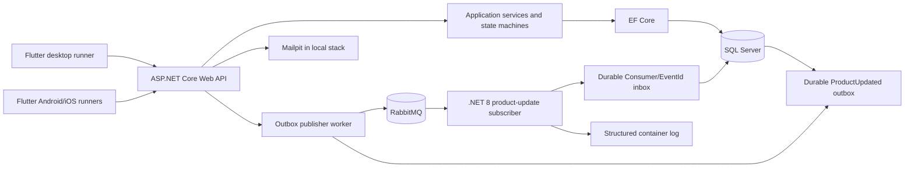
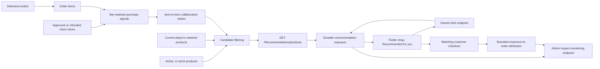
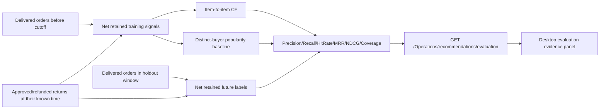
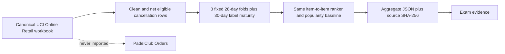
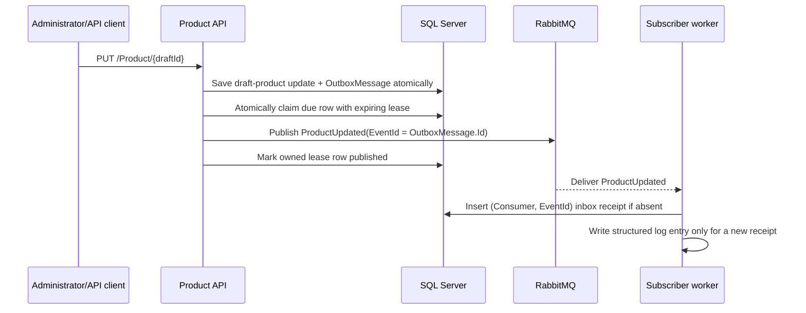
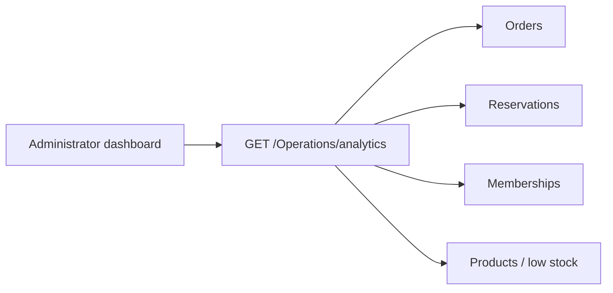

# PadelClub architecture

This document describes the architecture that is present in the repository as of
the exam-readiness implementation pass. It deliberately separates production-like
paths from development-only demonstration data and from work that remains out of
scope.

## Runtime view

The desktop package contains the shared Flutter feature code; the mobile package
provides the Android/iOS runners that import it. The API exposes JWT-protected
controllers and the services layer owns business rules and EF Core persistence.
Docker Compose provisions SQL Server, the API, Mailpit, RabbitMQ, and the
subscriber as separate services.

## Product recommendation flow

`ProductRecommendationService` builds implicit purchase signals from delivered
orders only. Approved and refunded returns reduce the retained quantity. The
ranker weights signals by quantity and recency, computes item-to-item cosine
similarity across other customers, and reduces weak associations with support
shrinkage. It excludes products already retained by the current user, inactive
or deactivated products, and items with no stock.

If history is sparse, the endpoint returns labelled popular or new-arrival
fallbacks rather than presenting them as personalised results. The response also
contains the ranking strategy, algorithm version, score, supporting-customer
count, and an explanation source. The score is a ranking value, not a probability.

Each returned item also has a server-issued exposure ID and immutable telemetry
source. Only production, active, email-verified Player sessions without an
Administrator role and with prior `CustomerCheckout` or `VerifiedImport`
history are stamped operational; development/demo, test, admin, unqualified,
other non-production, and pre-provenance rows are excluded from all maturity
metrics. The desktop shop can record an intentional player click and
attach that opaque ID to a matching checkout line. The API accepts a new click
only within seven days of serving and revalidates that timing during reporting;
an expired/replayed request cannot rewrite a historical CTR. Attribution also
requires the same authenticated player, same product, an operational source, a
prior valid click, one unused exposure, and the same seven-day window; invalid
tracking cannot alter the order. The administrator impact endpoint aggregates
only operational impressions, valid clicks, checkouts, delivered/cancelled
orders, and delivered revenue while disclosing excluded aggregate counts. It is
explicitly descriptive monitoring, not an A/B test, causal lift measure, or
customer-impact result.

Prospective causal collection is a separate, locked path. A player first opts
in through `Recommendations/analytics-consent`; only a production
`OperationalCustomer` with active consent can receive a sticky server-side
assignment in `product-recommendation-cf-vs-popularity-v1`. Treatment uses the
current collaborative filter and control uses the full deterministic
distinct-buyer popularity ranker, not merely the sparse-history fallback. New
exposures hold the immutable assignment ID; historical rows remain unassigned
and excluded. The administrator can create, start, close, inspect, and snapshot
the fixed protocol under `Operations/recommendations/experiments`. Its report
uses user-level attributed-checkout conversion and returns null lift/intervals
until closed, attribution-matured traffic reaches the pre-registered per-arm
and observation-day gates. It is therefore collection infrastructure, not a
claim that PadelClub already has a causal result.

## Historical evaluation flow

The evaluation endpoint uses an explicit global temporal split. It supplies the
cutoff time to the ranker, so post-cutoff events cannot affect training. Training
returns are known only through the cutoff; holdout returns are observed through
a 30-day maturity period after the selected end. It reports null metrics if
there is no warm evaluable cohort and flags cohorts under five users as small
samples. Development orders marked `IsSeededForDemo` are excluded before the
temporal split and reported as an excluded cohort count; they remain available
only to demonstrate the serving path. See
[the evaluation protocol](RECOMMENDATION_EVALUATION.md) for the candidate
catalog and historical-availability limits.

The panel distinguishes a mathematically available result from one that passes
its explicit operational data-sufficiency gates. A diagnostic result must not be
shown as a broad quality claim, and the current schema does not certify consent
or provenance for unmarked legacy rows.

## External benchmark evidence flow

`tools/PadelClub.RecommendationBenchmark` is intentionally outside the serving
and database paths. It evaluates the ranker over UCI's licensed, de-identified
retail transactions, writes counts/metrics/source hash only, and labels the
result as external algorithm evidence. It does not evaluate PadelClub customers
or establish conversion impact. The canonical workbook hash is enforced; UCI
cancellations are conservatively matched only to prior purchases of the same
customer/product and unmatched quantity remains visible. The current recorded
run contains 2,527 warm user-folds and a collaborative-filtering NDCG@6 of
7.76% versus 3.74% for popularity. The exact source hash, cleaning/netting
rules, return-maturity observations, per-fold results, and 11 gates live in the
generated benchmark JSON.

## Product-update messaging flow

`DraftProductState.UpdateAsync()` saves `ProductUpdated` as an `OutboxMessage`
in the same database transaction as the product mutation. The API-hosted
`OutboxPublisherWorker` atomically claims due rows with expiring SQL leases,
publishes them, and only an owning lease may mark them published; failed rows
retain an error and retry time. This permits multiple API replicas without
intentional concurrent publication and lets a later replica reclaim a crashed
owner's expired lease. The payload's stable `EventId` is the outbox row ID.
`ProductUpdatedSubscriber` keeps a stable subscription ID and writes a durable,
unique `(Consumer, EventId)` inbox receipt before logging a newly received event.
RabbitMQ and SQL connection strings are configured through connection strings,
and Compose supplies non-guest broker credentials plus the shared SQL database.
The RabbitMQ health check waits for the AMQP listener, while both the publisher
and subscriber use bounded recovery paths.

This is an observable **at-least-once** integration path, not an exactly-once
workflow. A process crash after broker publish but before the database
acknowledgement can re-send an event; lease expiry can also deliberately allow a
reclaim. The durable inbox makes repeated delivery harmless for this named
consumer, but the current intentionally limited business side effect is still
logging. It must not be described as a financial, notification, or
inventory-reconciliation worker yet.

## Return-resolution concurrency boundary

`PUT /Commerce/returns/{id}/resolve` starts a SQL Server serializable
transaction and claims the requested return row with `UPDLOCK, HOLDLOCK`. For a
Stripe-backed return it then commits a `ProviderRefundOperation` and changes the
return to `RefundPending` **before** any Stripe I/O. The operation contains an
immutable idempotency key, provider-payment snapshot, expected cumulative refund
total, retry state, error history, and an expiring SQL lease.

A hosted worker atomically claims due operations with `UPDLOCK, READPAST`, first
searches Stripe refund metadata for the stable operation ID, and otherwise uses
the same idempotency key to create the refund. In a final owner-checked SQL
transaction it records the provider refund ID, reconciles the payment total,
marks the return `Refunded`, and restores stock exactly once. A crash after a
provider acceptance therefore leaves a durable pending operation that can be
reconciled and settled later instead of an untracked Stripe/SQL split.

This is deliberately a recoverable saga, not a distributed ACID transaction.
It must not be described as a live Stripe proof without real Stripe test/live
credentials and an observed provider result.

## Client-complete commerce and account workflows

The Flutter client presents the following server-backed workflows rather than
leaving them as API-only contracts:

- **Customer returns:** **My orders** lists owner-scoped eligible delivered
  lines. A player selects quantities and gives a reason; the API revalidates the
  order, return window, quantities, and refund amount. The same screen shows
  server-returned request status, resolution time, and club note.
- **Membership self-service:** **Profile -> My memberships** shows only the
  signed-in player's status and activity history. It can change automatic
  renewal or schedule end-of-period cancellation. These are membership-record
  changes only; the client does not collect card data or create a payment.
- **Payment history:** **Profile -> Payment history** reads only the
  owner-scoped paged `GET /Payments/mine` response. It presents persisted
  payment, refund, provider, failure, and reconciliation fields for inspection;
  it cannot collect a card, start a payment, or issue a refund, and it does not
  imply that Stripe is configured locally.
- **Staff membership lifecycle:** **Memberships** in the desktop management
  navigation lists the server-paged membership work queue with type and active
  filters. Staff can set `Active`, `Suspended`, or `Cancelled`, extend a record
  for one to 24 months, and inspect immutable activity history. A renewal is
  explicitly a membership-record/manual fulfilment action; it does not collect
  payment details or claim a card charge.
- **Staff return resolution:** **Order Management -> Return requests** is a
  filtered, server-authoritative work queue. Staff can inspect, approve with a
  note, or reject a still-requested return, after which the client reloads the
  server result. The local concurrency and optional Stripe boundary remain the
  one described above.
- **Staff order fulfilment:** **Order Management -> Orders** exposes only the
  next valid state for each order: `Pending -> Processing -> Shipped ->
  Delivered`, with cancellation available only before dispatch. The server
  validates the same lifecycle, claims the SQL Server order row while applying
  it, timestamps an actual delivery, and restores stock at most once for a
  cancellation. Delivered and cancelled orders are terminal.
- **Tournament administration:** **Tournament Management** creates and edits
  server-backed tournaments, and exposes the existing confirmed hard-delete
  API explicitly. Administrators can also request one-way bracket generation.
  The server is authoritative: it rejects a second generation request and
  refuses to create a bracket without complete confirmed teams and an active
  court; player registration and bracket viewing remain separate player flows.
- **Coupon administration:** **Product Management -> Manage coupons** supports
  creating, editing, and enabling/disabling server-backed coupon rules, with
  validity, threshold, discount, and usage constraints visible in the refreshed
  snapshot.
- **Audit trail:** **Audit Trail** is an administrator-only, read-only view of
  server-recorded audit entries. It sends user, HTTP-method, and UTC start-date
  filters to the server and exposes correlation, actor, request, duration, and
  response details without editing or exporting records.
- **Notification delivery diagnostics:** **Notifications -> Delivery
  Diagnostics** is an administrator-only, read-only snapshot of the latest
  persisted email/push delivery attempts. Staff can filter server-side by
  status and inspect provider errors, schedules, attempts, and sent times. It
  is not a retry console or recipient read-receipt feature; local SMTP and
  Firebase configuration can intentionally be absent.
- **Provider readiness:** **Audit Trail -> Provider readiness** is an
  administrator-only, read-only local configuration-shape snapshot for Stripe,
  SMTP, and Firebase. It intentionally makes no provider calls and never
  displays credentials; its screen states that configuration is not proof of a
  charge, an external delivery, or recipient receipt.
- **Provider verification:** the separate administrator-only
  `POST /Operations/provider-verification/{stripe|smtp|firebase}` path is
  default-deny, requires `confirmExternalCall: true`, and takes no recipient,
  device, key, payment ID, or provider target from the client. A durable
  `Started` attempt is written before the bounded external action and becomes a
  normalized success/failure outcome only after it is observed. Stripe can only
  read a configured **test-mode** PaymentIntent; SMTP/FCM use fixed deployment
  targets and a correlation-only message. The evidence excludes credentials,
  target identifiers, raw provider errors, and provider object IDs. A succeeded
  row means provider acceptance of that narrow test action only—not payment,
  inbox/device delivery, read receipt, or live production proof.

## Live operations dashboard flow

The headline dashboard cards fetch administrator-only operational data for the
last 30 days. The remaining schedule and court-status panels are clearly labelled
example previews; they are not claimed to be live reservation or availability
views.

## Source evidence

- API composition and demo data: `PadelClub.WebAPI/Program.cs`
- Recommendation endpoint: `PadelClub.WebAPI/Controllers/RecommendationsController.cs`
- Ranking/data rules: `PadelClub.Services/Recommendations/ProductRecommendationService.cs`
  and `ItemBasedCollaborativeRanker.cs`
- Evaluation evidence client: `UI/padelclub_desktop/lib/features/recommendation_evaluation/`
- Formal data profile: `docs/RECOMMENDATION_DATA_PROFILE.md`
- External benchmark: `tools/PadelClub.RecommendationBenchmark/` and
  `scripts/Invoke-UciOnlineRetailBenchmark.ps1`
- Product event publisher: `PadelClub.Services/ProductStateMachine/DraftProductState.cs`
- Subscriber worker: `PadelClub.WebAPI/PadelClub.Subscriber/ProductUpdatedSubscriber.cs`
- Live dashboard provider: `UI/padelclub_desktop/lib/features/operations/presentation/providers/operations_analytics_provider.dart`
- Customer/staff return client: `UI/padelclub_desktop/lib/features/returns/` and
  `UI/padelclub_desktop/lib/features/orders/presentation/screens/order_management_screen.dart`
- Membership self-service and staff lifecycle clients:
  `UI/padelclub_desktop/lib/features/memberships/`
- Owner-scoped payment-history client:
  `UI/padelclub_desktop/lib/features/payment_history/`
- Coupon administration client: `UI/padelclub_desktop/lib/features/coupons/`
- Tournament administration client:
  `UI/padelclub_desktop/lib/features/tournament_management/`
- Read-only operations clients:
  `UI/padelclub_desktop/lib/features/operations/` and
  `UI/padelclub_desktop/lib/features/notifications/presentation/screens/notification_delivery_diagnostics_screen.dart`
- Local runtime topology: `docker-compose.yml`
- Isolated fresh-volume rehearsal: `docker-compose.clean.yml` and
  `scripts/Invoke-CleanComposeSmoke.ps1`

## Deliberate scope boundaries

- The recommender is deterministic online item-to-item collaborative filtering;
  it is not a persisted ML.NET model or a separately trained model. A
  reproducible historical backtest and an external real-transaction benchmark
  exist, but neither is a substitute for online A/B testing, provenance-backed
  PadelClub operational evidence, or a broader data-science pipeline.
- Online impression/click/checkout telemetry is deliberately bounded and
  aggregate-reported. It includes an explicit-consent, fixed prospective
  CF-versus-popularity experiment for future causal collection, but historic
  rows stay descriptive and no causal estimate appears until real production
  traffic passes the recorded gates.
- Client-complete Phase 3-8 workflows now include the Player Hub (profile,
  partners, tournament registration/invitation response/withdrawal/bracket, and
  match reporting/confirmation), customer return requests/status, membership
  self-service and owner-scoped payment history, staff reservation
  maintenance/no-show and return-resolution actions, staff membership and order
  fulfilment lifecycle actions,
  administrator tournament management/bracket generation, coupon management
  and inventory adjustment/history, read-only audit and delivery-attempt
  diagnostics, and privacy export/deletion controls. Other endpoints still
  need a visible, tested client workflow before they can be demonstrated as
  client-complete.
- Empty Stripe/Firebase values and the absence of third-party SMTP credentials
  in `.env.example` do not prove a live third-party integration; the configured
  local SMTP target is Mailpit for development inspection only. Stripe-return
  correctness uses a durable, provider-reconciled saga, but that is not a live
  provider proof and is intentionally not a distributed transaction.
- Compose validation and image builds are part of CI. The `compose-smoke` job
  is configured to run the isolated fresh-volume rehearsal, preserve its JSON
  result and diagnostics, check representative HTTP authorization, validation,
  and recommendation contracts, and verify cleanup of its unique resources.
  When the rehearsal writes evidence, diagnostic capture and the same labelled-
  resource cleanup postcondition are required for a passing result.
- The API test job additionally runs a disposable, digest-pinned SQL Server
  Testcontainers instance. It applies the real EF Core migration chain before
  exercising HTTP login, authorization, recommendations, evaluator provenance,
  and an inventory transaction. It is a focused relational API tier; the
  Compose rehearsal remains the broader API-to-RabbitMQ-to-worker proof.
- Both Flutter jobs pin Flutter 3.44.5. The mobile job analyzes, tests, and
  packages the Android runner; its runner-level widget test verifies the shared
  bootstrap reaches login and routes to the Android player shell with its five
  primary destinations without a live backend dependency.
  The broker-to-worker path has been verified against both the regular stack and
  an isolated fresh-volume stack. Product updates use a SQL transactional outbox;
  the current subscriber still intentionally has only a log side effect.
